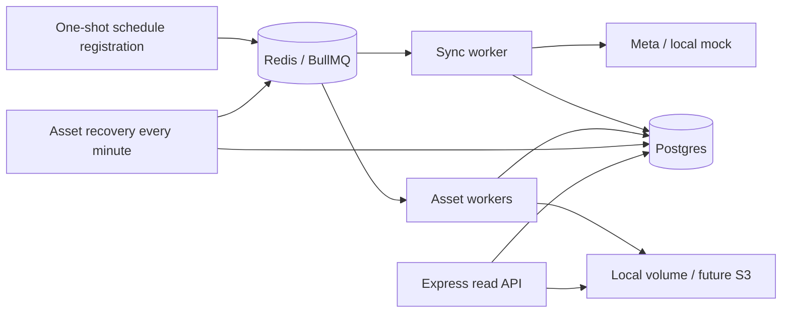

# Architecture

A modular monolith with independently runnable API and workers. Domain jobs depend on narrow ports where implementations genuinely vary: `MediaSource`, `AssetStorage`, and `JobQueue`. Knex repositories and migrations target Postgres deliberately; a database-agnostic abstraction is unnecessary for this assignment.

## Modules

| Module | Responsibility |
| --- | --- |
| `src/meta` | HTTP calls, field selection, response validation, opaque pagination cursors |
| `src/ingestion` | Bounded page traversal, sync lifecycle, per-hashtag/endpoint exclusion |
| `src/media` | Media model, metadata upserts, hashtag associations, asset intents |
| `src/assets` | Asset transfers, atomic local writes, persisted recovery |
| `src/queue` | Queue port and BullMQ adapter |
| `src/api` | Read routes and cursor validation |
| `src/db` | Connection configuration and advisory locks |
| `src/entrypoints` | Composition and process lifecycle |
| `migrations` | Versioned schema creation |

## Ingestion guarantees

Each endpoint job processes at most 500 returned media items, including duplicates. Pages are sequential and metadata commits per page. Duplicate IDs within a page are collapsed before persistence. The Meta adapter reduces oversized page requests and retries transient failures at the current cursor. Asset transfers run independently with bounded concurrency and streamed size limits. All Instagram IDs are strings to avoid JavaScript integer precision loss.

Unique primary keys and upserts make retries safe. Associations remember both top and recent sightings. A Postgres session advisory lock excludes simultaneous syncs for the same hashtag and endpoint across workers. Asset transfers also have per-asset locks. Work uses a dedicated lock connection and separate query connections; pool capacity includes both.

Metadata and pending asset rows are saved in the same database transaction. Recovery scans persisted pending rows every minute and failed rows after 15 minutes, then enqueues deterministic asset job IDs. This repairs a crash between database commit and queue publication without a distributed transaction. It is a small, polling form of durable work intent, not a general event outbox. Queue delivery is at least once; effects are idempotent.

A transfer writes to a unique temporary file and atomically renames it to a deterministic key. Only afterward does the database mark it ready. A crash after rename but before the database update is repaired by overwriting the same key on retry. Missing source URLs are explicitly unavailable. Source URLs are not returned by the API or logged.

## Ordering and pagination

`GET /hashtags` defaults to matcha and orders by Instagram `posted_at DESC, id DESC`. Here creation time means post creation time; `ingestedAt` separately records first local ingestion. The composite index supports the ordering. Cursor pagination uses the same tuple and fetches `limit + 1` rows; equal timestamps do not skip records. IDs use deterministic textual ordering as a tie-breaker, not numeric ranking. Cursors are versioned and bound to the hashtag.

The API is a live feed, not a snapshot across all pages: newly discovered older posts can appear on later pages. No costly total count is included.

## Scaling and AWS path

API processes can scale separately from workers. Run `docker compose up -d --scale worker=2` locally; each worker has one sync slot and configurable asset slots. Shared Postgres locks protect duplicate concurrent work. Redis persists to a volume using AOF and noeviction.

For AWS, implement `AssetStorage` with S3 streaming uploads and replace the asset serving route with S3 signed URLs or a CDN. Implement `JobQueue` with SQS and add an SQS consumer entry point; replace schedule registration with EventBridge. Domain ingestion and asset services stay reusable. Local volumes are suitable for containers on one host; use shared object storage before scaling across hosts.

For substantially larger deployments: add a globally coordinated Meta request limiter, explicit permanent-error handling, dead-letter review, database pool sizing per replica, retention policies, metrics, and a cursor/checkpoint recovery policy. Current BullMQ rate limiting is per sync job, not per Meta HTTP request. No claim of production readiness is made.
